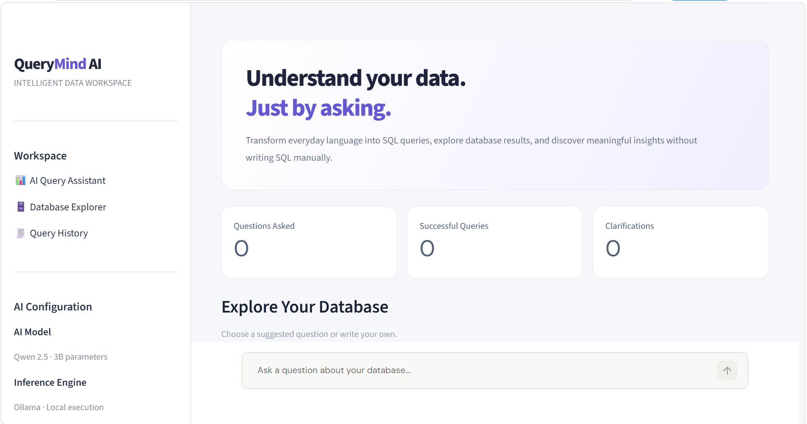
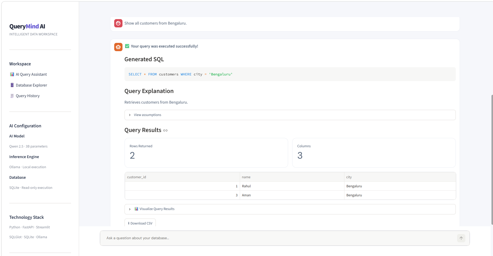
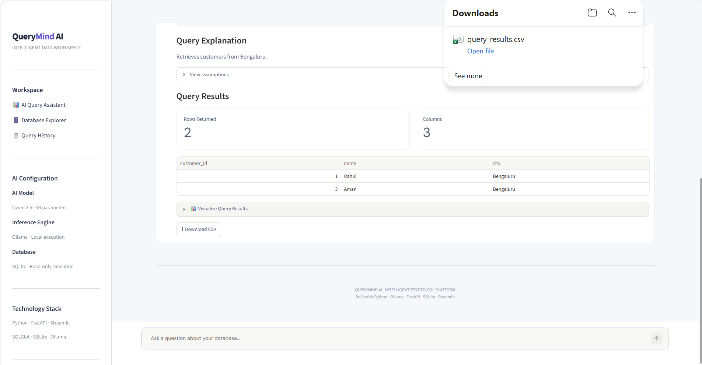

# QueryMind AI – Intelligent Text-to-SQL

**Convert natural language questions into SQL queries using Artificial Intelligence.**

QueryMind AI is an AI-powered Text-to-SQL application that allows users to interact with a relational database using simple English questions instead of writing SQL queries manually.

The application uses a locally running Large Language Model (LLM) to understand user questions, generate SQL queries, validate them, execute them against an SQLite database, and display results in an interactive dashboard.

## Project Overview

Working with databases often requires knowledge of SQL. QueryMind AI simplifies this process by allowing users to ask questions in natural language.

For example:

**User question:**
> Find the top 3 customers based on their total spending.

**Generated SQL:**
```sql
SELECT
    c.customer_id,
    c.name,
    SUM(o.amount) AS total_spending
FROM customers c
JOIN orders o
    ON c.customer_id = o.customer_id
GROUP BY c.customer_id, c.name
ORDER BY total_spending DESC
LIMIT 3;
```

The application executes the generated query and displays the results in a readable format.

## Key Features

- **Natural Language to SQL:** Convert English questions into SQL queries.
- **Local AI Integration:** Uses Ollama with Qwen 2.5 3B for local LLM inference.
- **Intelligent Clarification:** Identifies ambiguous questions and asks users for clarification.
- **SQL Validation:** Uses SQLGlot to parse and validate generated SQL.
- **Read-Only Query Execution:** Restricts database operations to read-only queries.
- **Interactive Dashboard:** Displays query results in a Streamlit interface.
- **Data Visualization:** Presents suitable query results through charts.
- **Query Results Export:** Download query results as CSV files.
- **SQLite Integration:** Works with a sample e-commerce database.

## System Architecture

```text
             User
               |
               v
       Streamlit Frontend
               |
               v
         FastAPI Backend
               |
               v
        Query Processing
               |
               v
       Ollama + Qwen 2.5 3B
               |
               v
        SQL Generation
               |
               v
         SQL Validator
           (SQLGlot)
               |
               v
        SQL Executor
               |
               v
          SQLite DB
               |
               v
       Query Results
               |
               v
      Interactive Dashboard
```

## Technology Stack

| Component | Technology |
|---|---|
| Programming Language | Python |
| Frontend | Streamlit |
| Backend | FastAPI |
| AI Model | Qwen 2.5 3B |
| Local LLM Runtime | Ollama |
| Database | SQLite |
| SQL Validation | SQLGlot |
| HTTP Requests | Requests |
| Data Processing | Pandas |
| API Testing | FastAPI Swagger UI |
| Version Control | Git and GitHub |

## Project Structure

```text
intelligent-text-to-sql/
│
├── app/
│   ├── core/
│   │   ├── config.py
│   │   └── llm.py
│   │
│   ├── database/
│   │   ├── setup.py
│   │   ├── schema.py
│   │   └── test_database.py
│   │
│   ├── services/
│   │   ├── sql_generator.py
│   │   ├── sql_validator.py
│   │   ├── sql_executor.py
│   │   └── query_pipeline.py
│   │
│   ├── frontend/
│   │   └── streamlit_app.py
│   │
│   └── main.py
│
├── tests/
├── evaluation/
├── .env.example
├── .gitignore
└── README.md
```

## How It Works

1. The user enters a question in natural language.
2. The backend receives the question through FastAPI.
3. The AI model interprets the question and generates SQL.
4. If the question is ambiguous, the application requests clarification.
5. The SQL validator checks the generated query.
6. The SQL executor runs the validated query against SQLite.
7. The results are returned to the frontend.
8. Streamlit displays the results in tables and visualizations.

## Installation and Setup

### 1. Clone the repository

```bash
git clone https://github.com/BhavithaMarikeeri/intelligent-text-to-sql.git

cd intelligent-text-to-sql
```

### 2. Create a virtual environment

```bash
python -m venv venv
```

Activate it on Windows:

```powershell
.\venv\Scripts\Activate.ps1
```

### 3. Install dependencies

```bash
python -m pip install fastapi uvicorn streamlit requests pandas sqlglot python-dotenv
```

### 4. Install Ollama

Download Ollama from:

https://ollama.com/

Pull the AI model:

```bash
ollama pull qwen2.5:3b
```

Make sure Ollama is running locally.

### 5. Configure environment variables

Create a `.env` file in the project root if needed:

```env
OLLAMA_BASE_URL=http://localhost:11434
OLLAMA_MODEL=qwen2.5:3b
```

### 6. Initialize the database

Run the database setup script:

```bash
python app/database/setup.py
```

### 7. Start the FastAPI backend

Open a terminal:

```bash
python -m uvicorn app.main:app --reload
```

Backend API:

http://127.0.0.1:8000

API documentation:

http://127.0.0.1:8000/docs

### 8. Start the Streamlit frontend

Open another terminal, activate the virtual environment, and run:

```bash
python -m streamlit run app/frontend/streamlit_app.py
```

The application will open in your browser.

## Example Questions

Try asking:

- Show all customers.
- Find all customers from Bengaluru.
- Find the top 3 customers based on their total spending.
- Show customers who have placed orders.
- Calculate the total revenue from all orders.

For ambiguous questions such as "Show me the best customers", the system can ask for clarification about the ranking criteria.

## Database Schema

The sample e-commerce database contains two tables:

**Customers**

| Column | Description |
|---|---|
| customer_id | Unique customer identifier |
| name | Customer name |
| city | Customer city |

**Orders**

| Column | Description |
|---|---|
| order_id | Unique order identifier |
| customer_id | Customer reference |
| amount | Order amount |
| order_date | Date of order |

The two tables are connected through `customer_id`.

## Security and Validation

QueryMind AI includes SQL validation before database execution.

- Uses SQLGlot to parse generated SQL.
- Rejects unsupported and destructive SQL operations.
- Allows read-only database execution.
- Uses a read-only SQLite connection for query execution.

**Note:** This is an educational and portfolio project. Additional security controls, authentication, and production hardening would be required before using it with sensitive or production databases.

## Deployment

The project is being prepared for a free public demonstration.

The full AI-powered version currently runs locally using Ollama. The planned public demo will use sample data and will not require the visitor to install Ollama.

## Future Enhancements

- Support for multiple database systems.
- Improved conversational memory.
- More advanced query evaluation.
- Database schema discovery.
- Query performance optimization.
- Authentication and user management.
- Public cloud deployment with hosted AI inference.

## Author

**Bhavitha Marikeeri**

GitHub: https://github.com/BhavithaMarikeeri
## 📸 Application Screenshots

### 1. QueryMind AI Dashboard


### 2. Natural Language to SQL Generation


### 3. Query Execution Results


### 4. Download Query Results
[Download Sample Query Results (CSV)](screenshots/query_results.csv)
---

*QueryMind AI – Making databases accessible through natural language.*
